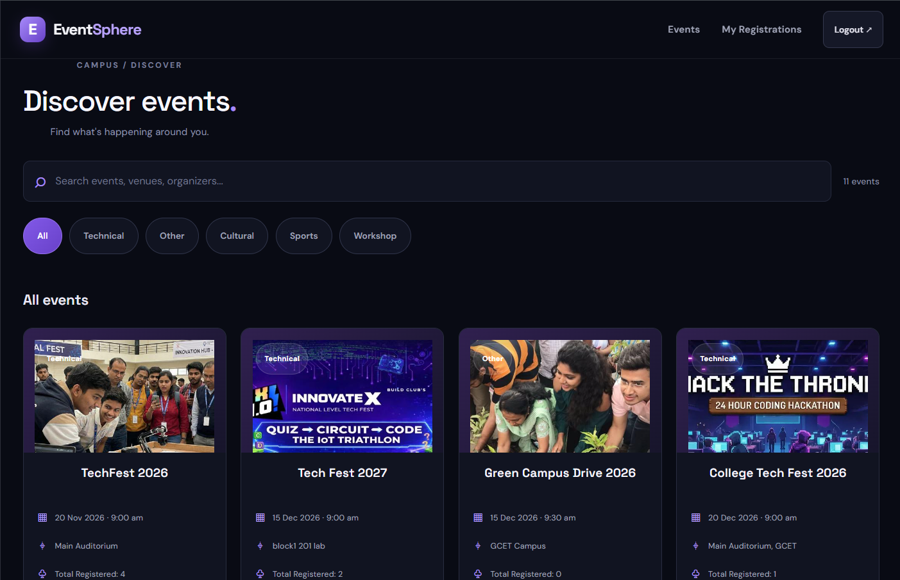
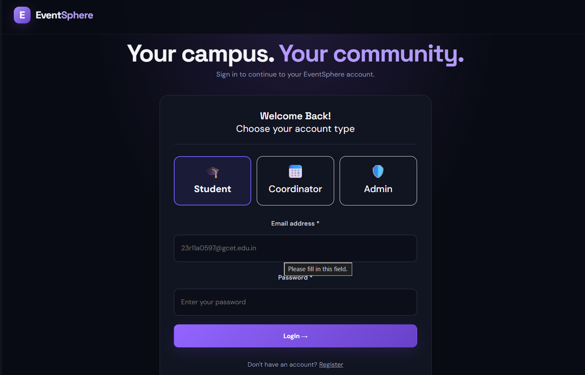
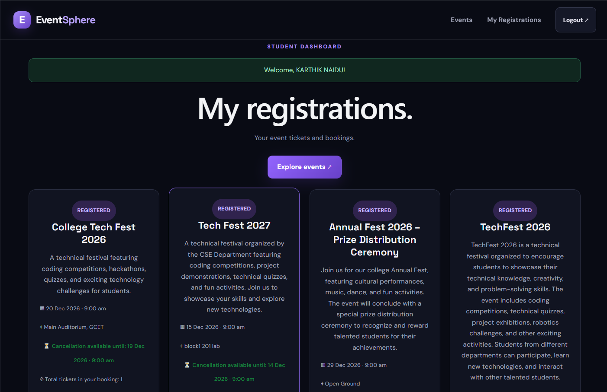
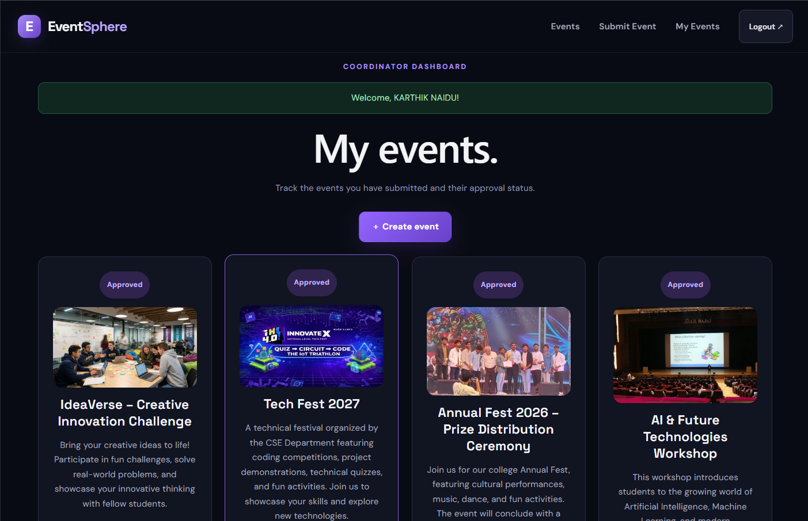
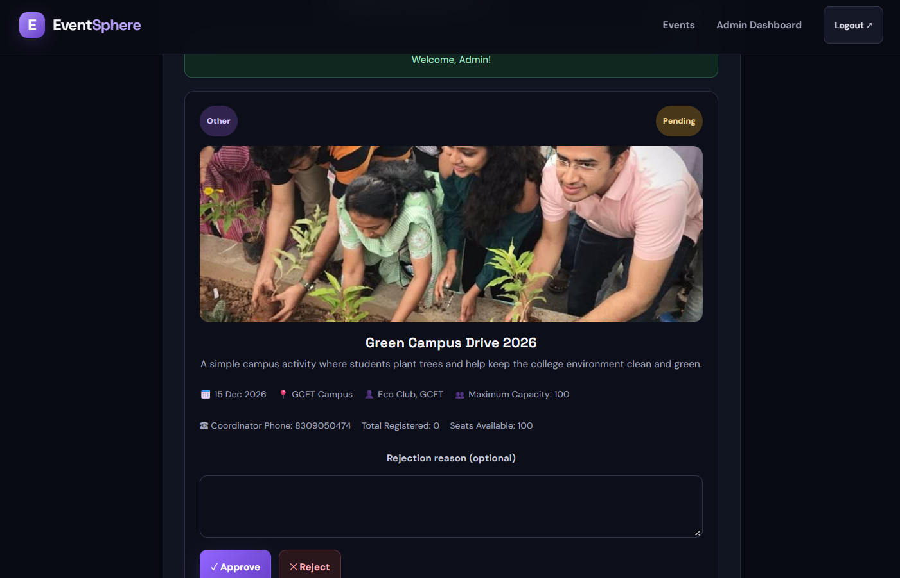

# 🎟️ EventSphere – College Event Management System

**EventSphere** is a full-stack MERN application designed to simplify college event management. It provides a platform where students can explore events, register for them, and manage their tickets, while coordinators and administrators can organize and manage events efficiently.

## 🌐 Live Demo

[**Visit EventSphere – Live Application**](https://eventsphere-frontend-beige.vercel.app/login)

## 📌 Project Overview

EventSphere is developed to make college event management easier and more organized. It provides separate dashboards and functionalities for Students, Coordinators, and Administrators.

The application supports event creation, event registration, ticket management, image uploads, and role-based access.

## ✨ Features

### 👨‍🎓 Student
- Student registration and login.
- Browse available college events.
- View event details and images.
- Register for events.
- Manage registered events and tickets.
- Cancel event registrations.

### 👨‍💼 Coordinator
- Coordinator login.
- Create and manage events.
- Upload event images.
- View event registrations.
- Manage event information.

### 🛡️ Admin
- Secure admin login.
- Admin dashboard.
- Manage users and events.
- Monitor event activities.
- Manage the overall platform.

### ⚙️ General Features
- Role-based authentication and authorization.
- JWT-based authentication.
- Responsive user interface.
- RESTful API integration.
- MongoDB database integration.
- Cloudinary image storage.
- Separate dashboards for different user roles.

## 🛠️ Technologies Used

| Category | Technologies |
|---|---|
| Frontend | React.js, HTML, CSS, JavaScript |
| Build Tool | Vite |
| Backend | Node.js, Express.js |
| Database | MongoDB Atlas |
| Authentication | JSON Web Token (JWT) |
| Image Storage | Cloudinary |
| API | REST API |
| Version Control | Git, GitHub |
| Deployment | Vercel |

## 📸 Screenshots

### 🏠 Home Page

### 🔐 Login Page

### 👨‍🎓 Student Dashboard

### 👨‍💼 Coordinator Dashboard

### 🛡️ Admin Dashboard
